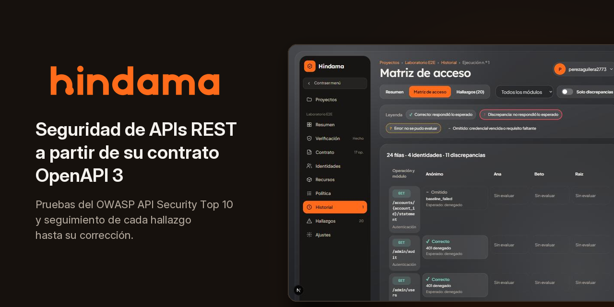

<p align="center">
  
</p>

# hindama-front



Interfaz web de **Hindama**: Next.js (React 19 + TypeScript) que funciona como BFF. El navegador solo habla con el servidor de Next.js, que guarda la sesión de Cognito en una cookie cifrada `HttpOnly` y llama a la API del backend; no contiene lógica de negocio (RNF-08).

La documentación del proyecto (requerimientos, arquitectura, contrato de la API, guía del frontend) vive en el repositorio [`hindama-docs`](https://github.com/The-Tito/hindama-docs). El contrato [`03-api/openapi.yaml`](https://github.com/The-Tito/hindama-docs/blob/main/03-api/openapi.yaml) es la fuente de verdad de la API; este repo guarda una copia en [`contract/openapi.yaml`](contract/openapi.yaml). La API vive en [`hindama-backend`](https://github.com/The-Tito/hindama-backend).

## Requisitos

- Node.js 22 (el mismo de la imagen de Docker) y npm.
- Para trabajar con datos reales: el backend en local (ver [entorno local y conexiones](https://github.com/The-Tito/hindama-docs/blob/main/03-api/entorno-local.md)) y un User Pool de Cognito. Sin backend se puede usar el simulador del contrato (`npm run mock:api`).

## Estructura

```
src/
├── app/            Rutas del App Router: [locale]/… (vistas) y api/… (rutas del BFF)
├── features/       Una carpeta por área: auth, projects, runs, config, account, admin, legal, errors
├── components/     ui, layout, dialogs y skeletons compartidos
├── server/bff/     Sesión, CSRF, llamadas a Cognito y a la API (solo servidor)
├── lib/            Cliente de la API tipado, consultas, utilidades
├── i18n/ messages/ next-intl: español (es.json) e inglés (en.json)
└── proxy.ts        Cabeceras de seguridad (CSP, HSTS), Origin y redirecciones por sesión
contract/           Copia del contrato OpenAPI
e2e/                Pruebas de punta a punta con Playwright
deploy/             Despliegue en EC2 con Docker Compose y Caddy
demo/               APIs vulnerables de prueba y guion de la demo
docs/               Notas del frontend (errores, animaciones, logo, inventario de vistas)
```

## Comandos

```bash
cp .env.example .env.local   # y completa las variables (ver el archivo)
npm install
npm run dev                  # https://localhost:3000
npm run lint                 # ESLint
npm run typecheck            # tsc --noEmit
npm run format:check         # Prettier
npm test                     # Vitest (antes verifica que la copia del contrato esté al día)
npm run e2e                  # Playwright
npm run build                # compilación de producción (salida standalone)
```

### Contrato de la API

- `npm run contract:types` regenera los tipos de `src/lib/api/schema.d.ts` desde `contract/openapi.yaml`.
- `npm run contract:check` compara la copia local con la de `hindama-docs`; corre solo antes de `npm test`.
- `npm run mock:api` levanta un simulador del contrato con Prism en `127.0.0.1:4010`.

### Seguridad del BFF

La cookie de sesión es `__Host-` (HTTPS, sin dominio), las peticiones que modifican datos exigen token anti-CSRF y verificación de `Origin`, y las cabeceras (CSP, HSTS y demás) se fijan en [`src/proxy.ts`](src/proxy.ts). Las llaves y el secreto del cliente de Cognito solo se leen en el servidor: en local de `.env.local`, en producción de SSM Parameter Store. Ver [`.env.example`](.env.example).

## Despliegue

El frontend se despliega en su propia EC2 con Docker y Caddy. El procedimiento completo está en [`deploy/README.md`](deploy/README.md).

## Demo

[`demo/README.md`](demo/README.md) explica cómo encender el laboratorio vulnerable (o VAmPI) con un túnel público para probar Hindama de punta a punta.

## Equipo

| Persona | Rol | GitHub |
| --- | --- | --- |
| Luis Angel Perez Aguilera | Frontend | [@lsprz2773](https://github.com/lsprz2773) |
| Luis Antonio Selvas de Leon | Backend | [@The-Tito](https://github.com/The-Tito) |

Proyecto de la materia Seguridad Informática, Universidad Politécnica de Chiapas (equipo Hindama 7B).

## Licencia

Licencia propietaria: ver [`LICENSE`](LICENSE). Hindama ejecuta pruebas de seguridad; úsalo solo contra APIs propias o con autorización expresa.
